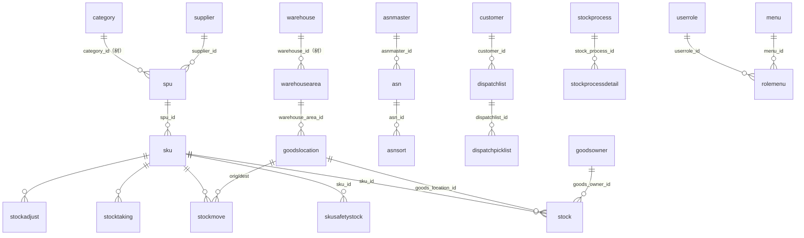
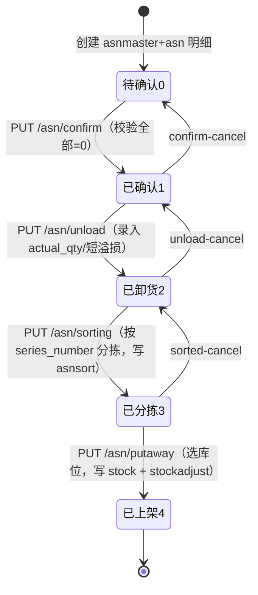
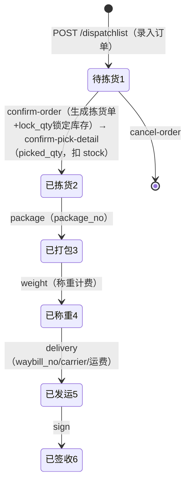

# ModernWMS 逆向工程报告

> 逆向对象：开源仓库管理系统 ModernWMS（Apache 2.0）
> 源码位置：`F:\WMS\ModernWMS`
> 逆向方式：纯源码静态分析（.NET 7 后端 + Vue 3 前端）
> 产出日期：2026-10-15

---

## 1. 项目概览与技术栈

ModernWMS 是一套面向中小企业的简易完整 WMS（仓库管理系统），覆盖 入库 → 库存 → 出库 → 库内作业（移库/调整/冻结/盘点/加工）全流程。

| 层 | 技术 | 版本 |
|---|---|---|
| 后端框架 | ASP.NET Core (ModernWMS.sln) | .NET 7.0 |
| ORM | Entity Framework Core | 7.x |
| 数据库 | MySQL 8（默认）/ SQL Server 2017+ / PostgreSQL 12 / SQLite，配置切换 | — |
| 认证 | JWT Bearer + RefreshToken（内存缓存） | — |
| 定时任务 | Hangfire（MemoryStorage，队列 wms） | — |
| 序列化 | Newtonsoft.Json（驼峰、日期 yyyy-MM-dd HH:mm:ss）+ Mapster | — |
| 日志 | NLog（nlog.config） | — |
| i18n | 资源文件 resx（zh-cn / en-us） | — |
| 前端框架 | Vue 3.2.45 + TypeScript 4.9 + Vite 4 | — |
| UI | Vuetify 3.3.12 + vxe-table 4.3.7 | — |
| 状态管理 | Vuex 4 + vuex-persist（**不是 Pinia**） | — |
| 路由 | vue-router 4（hash 模式，**后端菜单驱动动态路由**） | — |
| HTTP | axios 1.2.1（token 过期自动刷新 + 请求重放队列） | — |
| 其他 | echarts（报表大屏）、exceljs/xlsx（导入导出）、hiprint/jsbarcode/qrcode（打印与条码） | — |

**部署形态**：nginx 托管前端静态文件（:80）+ dotnet 后端直连（:20011 或 :21011），前后端跨端口、后端自带 CORS 中间件。默认账号 `admin / 1`。

---

## 2. 后端架构

### 2.1 三项目职责与依赖

```
ModernWMS.sln
├── ModernWMS          宿主层：Program.cs / Startup.cs / appsettings.json / wms.db(SQLite种子库)
├── ModernWMS.Core     框架层：与业务无关的基建
└── ModernWMS.WMS      业务层：Controllers / IServices / Services / Entities
依赖方向：ModernWMS → ModernWMS.WMS → ModernWMS.Core
```

| 项目 | 职责 | 关键内容 |
|---|---|---|
| **ModernWMS** | 启动宿主，只有 2 个 .cs | `Startup.cs` 全部委托给 `StartupExtensions` |
| **ModernWMS.Core** | 框架基建 | `SqlDBContext`、`BaseService`（泛型 CRUD）、JWT（TokenManager/CurrentUser/CacheManager）、中间件（CORS/全局异常/请求日志/ViewModelActionFiter）、多租户 TenantProvider、`IDependency` 自动装配、Hangfire `IJob` 抽象、MultiLanguage 资源、user/userrole 实体、`AccountController`（/login、/refresh-token） |
| **ModernWMS.WMS** | 全部业务 | 23 个 Controller、Services/IServices（**无独立 Repository 层**，服务直接用 DbContext + BaseService）、32 个实体 + 约 90 个 ViewModel |

### 2.2 四个核心自动装配机制（逆向重点）

这套框架的精髓在 `ModernWMS.Core/Extentions/StartupExtensions.cs`，新增模块**零配置**：

1. **实体自动发现**（`SqlDBContext.MappingEntityTypes`）：反射扫描所有 `ModernWMS*.dll` 中继承 `BaseModel` 的类，自动注册进 EF 模型——**不需要手写 DbSet**，新建实体类继承 `BaseModel` 即自动建表。`GetDbSet<T>()` 泛型取表。
2. **服务自动注入**（`RegisterAssembly`）：实现 `IDependency` 接口的 类/接口对 自动 `AddScoped`。每个业务 Service 实现 `IXxxService : IDependency` 即完成注册。
3. **定时任务自动注册**（`AddHangfireJob`）：实现 `Core.Job.IJob` 的类自动注册为 Hangfire RecurringJob（自带 CronExpression）。
4. **数据库 provider 配置切换**：`appsettings.json → Database:db` 一个字段切 MySQL / SQLSERVER / POSTGRES / SQLLITE，连接串分键配置。

### 2.3 认证与权限

- `POST /login`（`ModernWMS.Core/Controller/AccountController.cs`，AllowAnonymous）→ `AccountService.Login` 校验 `user.auth_string`（MD5，前端 `ts-md5` 加密后传输）→ 签发 access_token（默认 60 分钟，`TokenSettings` 可配）+ refresh_token（存内存 CacheManager）。
- `POST /refresh-token` 用旧 token + refresh_token 换新 token。
- JWT 校验失败/无权限返回统一由 `ApiResponseHandler` 处理。
- **权限模型**：user → userrole（角色）→ rolemenu（角色×菜单，authority + `menu_actions_authority` 按钮级权限 JSON）→ menu（`vue_path`/`vue_directory` 驱动前端动态路由）。
- **多租户**：所有业务表带 `tenant_id` 字段，`TenantProvider` 从当前用户取值（过滤逻辑部分被注释，属半成品状态）。
- 操作审计：`actionlog` 表记录 vue_path + user + action_content。

### 2.4 请求管道（StartupExtensions.UseExtensionsConfigure）

```
StaticFiles → Swagger → Routing → CorsMiddleware → Authentication(JWT)
→ Authorization → GlobalExceptionMiddleware → RequestLocalization(zh-cn默认)
→ Hangfire Server+Dashboard → MapControllers
```

---

## 3. 数据库逆向

### 3.1 表清单（32 张，按业务域分组）

所有实体继承 `BaseModel`（主键 `int id`，EF 显式值生成），业务表均含 `tenant_id`。

**基础资料**

| 表 | 实体 | 关键字段 |
|---|---|---|
| company | CompanyEntity | company_name, city, address, manager, contact_tel |
| warehouse | WarehouseEntity | warehouse_name, city, address, email, manager, contact_tel, is_valid |
| warehousearea | WarehouseareaEntity | warehouse_id, area_name, parent_id(区域树), area_property(库区属性) |
| goodslocation | GoodslocationEntity | warehouse_id, warehouse_area_id, location_name, 长/宽/高/体积/承重, roadway/shelf/layer/tag_number(巷道/货架/层/标签) |
| customer | CustomerEntity | customer_name, city, address, manager, contact_tel |
| supplier | SupplierEntity | supplier_name, city, address, manager, contact_tel |
| goodsowner | GoodsownerEntity | goods_owner_name, city, address, manager, contact_tel |
| freightfee | FreightfeeEntity | carrier, departure_city, arrival_city, price_per_weight, price_per_volume, min_payment |

**商品**

| 表 | 实体 | 关键字段 |
|---|---|---|
| category | CategoryEntity | category_name, parent_id(分类树) |
| spu | SpuEntity | spu_code/name, category_id, supplier_id, brand, origin, 长/重/体积单位, detailList→Sku |
| sku | SkuEntity | spu_id, sku_code/name, bar_code, weight, 长/宽/高/体积, unit, cost, price, detailList→安全库存 |
| skusafetystock | SkuSafetyStockEntity | sku_id, warehouse_id, safety_stock_qty |

**入库（ASN）**

| 表 | 实体 | 关键字段 |
|---|---|---|
| asnmaster | AsnmasterEntity | asn_no, asn_batch, estimated_arrival_time, asn_status, goods_owner_id, weight/volume |
| asn | AsnEntity | asnmaster_id, asn_no, asn_status, spu_id, sku_id, asn_qty, actual_qty, arrival/unload_time, sorted/shortage/more/damage_qty, supplier_id, goods_owner_id, series_number相关(expiry_date/price), is_valid |
| asnsort | AsnsortEntity | asn_id, sorted_qty, series_number, putaway_qty |

**出库（Dispatch）**

| 表 | 实体 | 关键字段 |
|---|---|---|
| dispatchlist | DispatchlistEntity | dispatch_no, dispatch_status, customer_id, sku_id, qty, lock_qty, picked_qty, package_qty, weighing_qty, sign_qty, intrasit_qty, damage_qty, package_no/person/time, weighing_no/weight, waybill_no, carrier, freightfee, pick_checker |
| dispatchpicklist | DispatchpicklistEntity | dispatchlist_id, goods_owner_id, goods_location_id, sku_id, pick_qty, picked_qty, is_update_stock, series_number, picker_id, expiry_date, price, putaway_date |

**库存与库内作业**

| 表 | 实体 | 关键字段 |
|---|---|---|
| stock | StockEntity | sku_id, goods_location_id, goods_owner_id, qty, is_freeze, series_number, expiry_date, price, putaway_date, last_update_time |
| stockmove | StockmoveEntity | job_code, move_status, sku_id, orig/dest_goods_location_id, qty, handler |
| stockadjust | StockadjustEntity | job_code, sku_id, goods_location_id, qty, job_type(增/减), source_table_id, is_update_stock |
| stockfreeze | StockfreezeEntity | job_code, job_type(冻结/解冻), sku_id, goods_location_id, handler, series_number |
| stocktaking | StocktakingEntity | job_code, job_status, sku_id, goods_location_id, series_number, book_qty(账面), counted_qty(实盘), difference_qty(差异), handler, handle_time |
| stockprocess / stockprocessdetail | StockprocessEntity | job_code, job_type, process_status, processor；明细 is_source(原料/产出), qty, is_update_stock |

**系统**

| 表 | 实体 | 关键字段 |
|---|---|---|
| user | userEntity | user_num, user_name, contact_tel, user_role, sex, is_valid, auth_string(密码), email, tenant_id |
| userrole | UserroleEntity | role_name, is_valid |
| menu | MenuEntity | menu_name, module, vue_path, vue_path_detail, vue_directory(前端动态路由目录), sort, menu_actions(JSON按钮权限) |
| rolemenu | RolemenuEntity | userrole_id, menu_id, authority, menu_actions_authority(JSON按钮授权) |
| actionlog | ActionLogEntity | vue_path, user_name, action_content, action_time |
| printsolution | PrintSolutionEntity | vue_path, tab_page, solution_name, config_json, 纸张长宽/方向 |
| globaluniqueserial | GlobalUniqueSerialEntity | 全局唯一序列号（单号生成） |
| flowset / flowsetfilter / flowsetmain / flowsetuser | FlowSet*Entity | 审批流配置（服务层存在，但未发现对应 Controller，疑似未启用/预留） |

### 3.2 ER 关系图



> 注意：项目实际以**逻辑外键**（int 字段）关联，未使用数据库物理外键约束；多对多关系全部通过明细表表达。

---

## 4. API 接口逆向

统一前缀即 Controller Route（无 /api 前缀），响应统一 `ResultModel<T>` 包装。以下按模块列出（`POST list` 均为 DynamicSearch 动态条件分页查询）。

**账户**（ModernWMS.Core）：`POST /login`、`POST /refresh-token`、`POST /hello-world`

| 模块 | 路由 | 主要端点 |
|---|---|---|
| 入库 | `asn` | asnmaster: list/GET/POST/PUT/DELETE；asn: list/CRUD；`bulk-modify-goods-owner`、`confirm`(+cancel)、`unload`(+cancel)、`sorting`(GET/PUT/modify)、`sorted`(+cancel)、`pending-putaway`、`putaway`、`print-sn` |
| 出库 | `dispatchlist` | list、advanced-list、by-dispatch_no、confirm-check、pick-list、confirm-order、confirm-pick-dispatchlistno、confirm-pick-detail(+cancel)、package、weight、delivery、freightfee、sign、cancel-order、import |
| 库存查询 | `stock` | stock-list、safety-list、location-list、select、sku-select、qrcode-list、delivery-list、stock-age-list（全部 POST 查询） |
| 移库 | `stockmove` | list/all/CRUD |
| 调整 | `stockadjust` | list |
| 冻结 | `stockfreeze` | list/all/CRUD |
| 加工 | `stockprocess` | list/all/CRUD、`process-confirm`、`adjustment-confirm` |
| 盘点 | `stocktaking` | list/GET/POST/PUT/DELETE、`adjustment-confirm` |
| 商品 | `spu` | list、GET、sku、sku-bar-code、CRUD、sku-safety-stock |
| 分类 | `category` | all、CRUD |
| 仓库 | `warehouse` | select-item、list/all/CRUD、excel导入 |
| 库区 | `warehousearea` | areas-by-warehouse_id、list/all/CRUD |
| 库位 | `goodslocation` | location-by-warehouseare_id、list/all/CRUD |
| 客户/供应商/货主/运价 | `customer`/`supplier`/`goodsowner`/`freightfee` | list、all、CRUD、excel |
| 公司 | `company` | all、CRUD |
| 用户 | `user` | select-item、list/all、CRUD、register、excel、reset-pwd、change-pwd |
| 角色 | `userrole` | save、all、CRUD |
| 菜单权限 | `rolemenu` | authority（登录后拉菜单）、all、menus、CRUD |
| 日志 | `actionlog` | list |
| 打印模板 | `PrintSolution` | list、all、get-by-path、CRUD |

**通用 CRUD 模式**：每个基础资料控制器都是 `POST list`（动态分页）+ `GET {id}` + `POST`（新建）+ `PUT`（更新，含批量）+ `DELETE`（ids 数组）。

---

## 5. 核心业务流程逆向

### 5.1 入库流程（ASN 状态机）

`asn_status`（byte）：**0 待确认 → 1 已确认 → 2 已卸货 → 3 已分拣 → 4 已上架（完成）**



关键逻辑（`Services/Asn/AsnService.cs`）：
- **confirm**：仅允许状态 0 → 1；cancel 反向回退。
- **unload**：录入 actual_qty、shortage/more/damage_qty。
- **sorting**：按序列号生成 `asnsort` 记录（sorted_qty / putaway_qty）。
- **putaway**：`pending-putaway` 查可上架明细 → 指定 goods_location → 写 `stock`（sku×库位×货主×序列号 维度）并生成 `stockadjust`（job_type、source_table_id 关联 asn，`is_update_stock=true`），状态置 4。
- 状态校验严格：例如 unload 只允许 `asn_status == 1`，否则报错。

### 5.2 出库流程（Dispatch 状态机）

`dispatch_status`（byte）：**1 待拣货 → 2 已拣货 → 3 已打包 → 4 已称重 → 5 已发运 → 6 已签收**



关键逻辑（`Services/Dispatchlist/DispatchlistService.cs`）：
- **confirm-order**：按 stock（库位/序列号/效期）生成 `dispatchpicklist` 拣货明细，`lock_qty` 锁定库存防超卖。
- **confirm-pick-detail**：拣货确认，`is_update_stock=true` 时扣减 `stock` 并写 `stockadjust`（出库方向）。
- **freightfee**：按承运商运价表（首重/续重/体积价/最低消费）自动算运费。
- 各环节 cancel 支持逐步回退（package/weight/delivery 均有反向逻辑）。

### 5.3 库内作业

| 作业 | 模型 | 流程 |
|---|---|---|
| 盘点 stocktaking | book_qty / counted_qty / difference_qty | 创建盘点任务（job_status=false）→ 录入实盘数 → `adjustment-confirm` 按 difference_qty 生成 stockadjust 更新 stock，job_status=true |
| 移库 stockmove | orig/dest_goods_location_id | 创建 → 执行：源库位 stock 减、目标库位 stock 增（经 stockadjust 记账） |
| 冻结 stockfreeze | job_type(bool) | 冻结：`stock.is_freeze=true`（冻结库存不可被出库拣选）；解冻反之 |
| 调整 stockadjust | job_type(增/减) | 其他作业的通用记账层：所有 stock 变动都留 stockadjust 流水（source_table_id 溯源） |
| 加工 stockprocess | 主单+明细 is_source | 原料明细(is_source=true) 扣库 → 产出明细 入库，`process-confirm` / `adjustment-confirm` 两段确认 |

**库存维度模型**：`stock = (sku_id, goods_location_id, goods_owner_id, series_number, expiry_date, price, putaway_date)` 粒度，支持序列号/批次/效期管理，`is_freeze` 冻结位。

### 5.4 序列号生成

`globaluniqueserial` 表 + 服务保证单号全局唯一（asn_no/dispatch_no/job_code 等）。

---

## 6. 前端架构逆向

### 6.1 目录结构

```
frontend/src
├── api/          base(基础资料12个) / sys(login,system) / wms(业务13个)
├── view/         页面（与后端 menu.vue_directory 一一对应）
│   ├── base/         基础资料：commodityCategorySetting 商品分类、commodityManagement 商品、
│   │                 customer、supplier、ownerOfCargo 货主、warehouseSetting 仓库、freightSetting 运价、
│   │                 userManagement、userRoleSetting、roleMenu、companySetting、print 打印模板
│   ├── wms/          stockAsn 入库、stockManagement 库存
│   ├── warehouseWorking/  warehouseMove 移库、warehouseAdjust 调整、warehouseFreeze 冻结、
│   │                      warehouseTaking 盘点、warehouseProcessing 加工
│   ├── deliveryManagement/ 出库管理
│   ├── statisticAnalysis/  统计分析（echarts）
│   ├── home/ login/ vwms/ largeScreen/ pageTemplate/
├── store/        Vuex：module/system.ts、module/user.ts（vuex-persist 持久化）
├── languages/    vue-i18n（zh-cn / en-us）
├── utils/http/   axios 封装
└── components/ constant/ plugins/ types/
```

### 6.2 动态路由机制（与后端 menu 表联动）

`src/router/index.ts`：静态路由只有 `/login` 和 `/home`(布局) → 登录成功后 `GET /rolemenu/authority?userrole_id=` 拉取该角色菜单 → `menusToRouter()` 把 `menu.vue_directory` 映射为 `import.meta.glob('../view/*/*/*.vue')` 的动态 import → addRoute。**菜单即路由，权限即菜单**。

### 6.3 HTTP 层

`src/utils/http/request.ts`：
- `baseURL = VITE_BASE_PATH + ':' + VITE_SERVER_PORT`（.env.production 默认 `http://127.0.0.1:20011`，部署时 sed 替换 IP）。
- 拦截器：token 过期检测 → 自动用 refresh_token 换新 → **期间挂起的请求进订阅队列，刷新成功后统一重放**；401 跳登录。
- 全局 loading 由 `acitveAxios` 计数器 + mitt 事件总线驱动。

### 6.4 状态管理（Vuex）

- `user` store：token、过期时间、用户信息、**menulist（菜单/路由数据）**。
- `system` store：语言、主题等 UI 状态。
- vuex-persist 持久化到 localStorage，刷新页面不丢登录态。

### 6.5 通用页面模式

基础资料页面共用 pageTemplate 模式：vxe-table 表格 + Vuetify 表单对话框 + `POST list` 动态查询（DynamicSearch 拼接条件）+ exceljs/xlsx 导入导出 + hiprint 打印模板（printsolution.config_json 存模板配置）。

---

## 7. 部署逆向

### 7.1 官方方式（docker/ 目录）

- **单容器方案**：`ubuntu:22.04` 基础镜像 → 装 aspnetcore-runtime-7.0 + nginx + node16 → 拷入编译产物（/frontend 静态 + /app 后端）→ run.sh 同时拉起 nginx(:80) 和 dotnet(:21011)。
- **裸机方案**（README）：前端 `yarn build` 产物丢 nginx html；后端 `dotnet publish` 后 `dotnet ModernWMS.dll --urls http://0.0.0.0:20011`；需自行 sed 替换 `.env.production` 中的部署 IP。
- nginx.conf 仅托管静态文件，**无 /api 反代**（API 路径与前端 hash 路由共用根路径，无法按前缀代理），前端直连后端端口，跨域由后端 CorsMiddleware 放行。

### 7.2 数据库初始化

- SQLite 档：仓库自带 `backend/ModernWMS/wms.db`（含菜单/管理员种子数据），连接串 `Data Source=wms.db` 即用。**但该种子库 schema 与代码实体严重脱节（见第 8 章风险 9），直接用会写操作报错。**
- MySQL/PG/SQLServer：需自建 `wms` 库并改 `appsettings.json` 的 `Database:db` + 对应连接串。
- ⚠️ 实测澄清：代码里 `EnsureCreated` 从未被调用、也无 EF 迁移程序集生效——**启动不会自动建表**，MySQL 档必须手动导入建表 SQL。

### 7.3 配置项速查（appsettings.json）

| 键 | 说明 | 默认 |
|---|---|---|
| Database:db | 数据库类型 | MySql |
| ConnectionStrings:* | 四种库连接串 | 本机默认 |
| TokenSettings:ExpireMinute | JWT 有效期 | 60 分钟 |
| TokenSettings:SigningKey | JWT 签名密钥 | ModernWMS_SigningKey（**生产必须改**） |
| SwaggerSettings | Swagger 开关与文档 | 开启 |
| Hangfire Dashboard | /hangfire | 无鉴权（**生产必须加**） |

---

## 8. 逆向结论与二次开发要点

**优点**
1. 自动装配机制（实体/服务/任务零配置注册）扩展成本低：新业务 = 实体 + Service(IDependency) + Controller 三件套。
2. 四库可切换，SQLite 档零依赖演示。
3. 库存记账模型清晰：stock 是唯一事实，stockadjust 是统一流水，可溯源。
4. 序列号/批次/效期/冻结/安全库存完整，小型 WMS 该有的都有。

**短板/风险（重建时建议修正）**
1. **无单元测试、无 Repository 层**，业务逻辑与 EF 查询耦合在 Service 里。
2. **密码 MD5 存储**（auth_string），应换 PBKDF2/bcrypt。
3. JWT SigningKey 默认值 + Hangfire Dashboard 无鉴权，生产裸奔风险。
4. 多租户过滤逻辑半成品（代码有注释残留），tenant_id 只是字段没强制过滤。
5. 动态查询 DynamicSearch 拼接条件，需确认参数化防注入。
6. 前端 Vue 3.2 + TS 4.9 + Node16 已偏旧；Vuex 可迁 Pinia。
7. `dispatchlist` 是"明细级订单"模型（一行一个 sku），主单/子单分离不彻底。
8. FlowSet 审批流实体与服务存在但未接 Controller，属未完成特性。
9. **官方 wms.db 种子库 schema 严重过期**（实测发现）：与代码中的 EF 实体模型不匹配——缺 9 张表（asnmaster、global_unique_serial、sku_safety_stock、flowset* 等）、数十列缺失（asn 的 asnmaster_id/arrival_time/expiry_date/price、dispatch 系列的 pick_checker、stock 系列的 series_number/expiry_date/price 等）、spu 还残留脏列 `bar_code`。直接部署会在建 SPU、入库等写操作时报 `NOT NULL constraint failed` / `no such table` / `no such column`。另外报告 7.2 所述"表结构由 EF EnsureCreated 生成"与实际不符：`EnsureCreated` 从未被调用、无 EF 迁移，MySQL 等库不会自动建表。**重建版 `rebuild/seed/wms.db` 已完成 schema 对齐修复并用完整入库流程验证通过。**
10. API 语义易踩坑：入库流程状态接口全为 PUT（confirm/unload/sorting/sorted/putaway）且收 JSON 数组；sorting 只记明细、需再调 sorted 才推进状态；默认管理员密码为 `1`（MD5 存储）。

**复用建议**：若以其为基底做自己的 WMS，保留 Core 框架层的自动装配思路与 stock/stockadjust 记账模型，重写认证（MD5→PBKDF2）、补测试、把 DynamicSearch 换成表达式树参数化。配套交付见 `rebuild/`（干净部署版）与 `scaffold/`（核心脚手架）。
